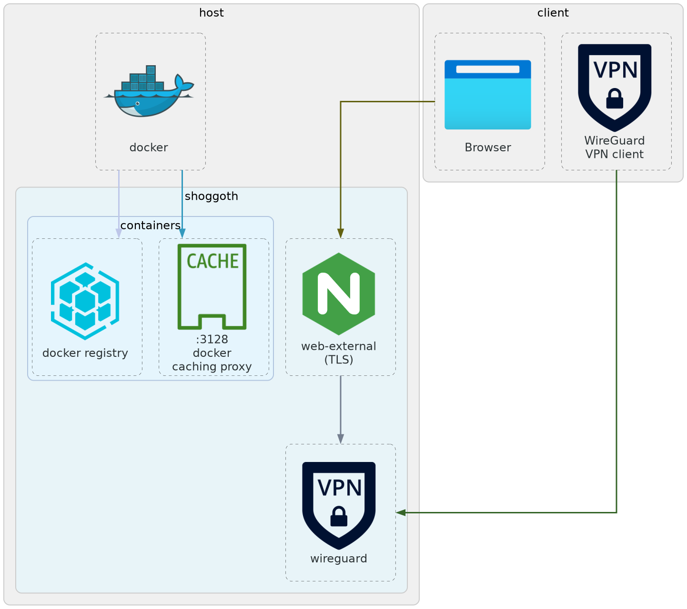
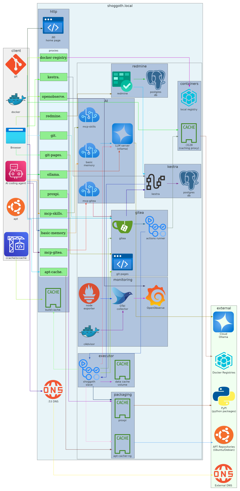
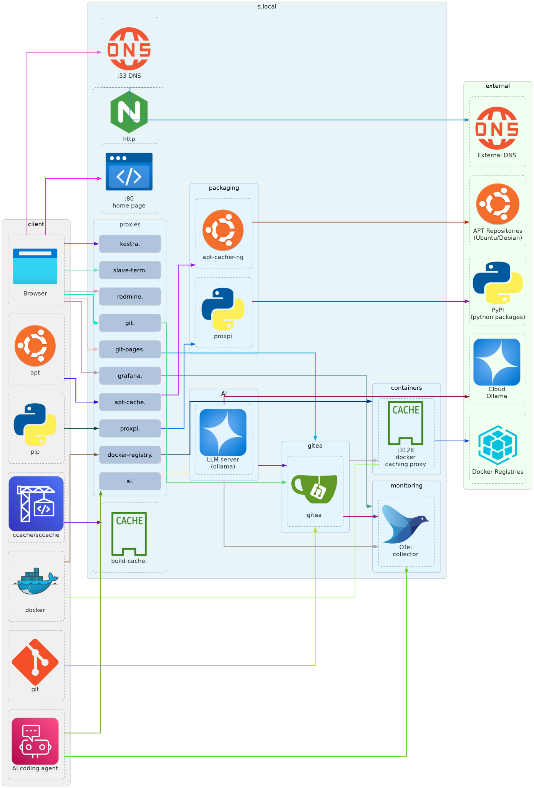
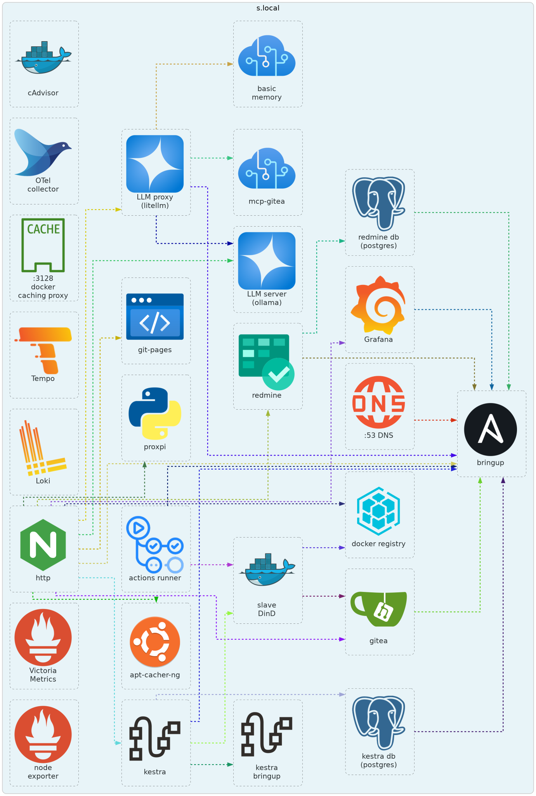

- [Introduction](#introduction)
  - [Goals](#goals)
  - [Disclaimer](#disclaimer)
  - [Requirements](#requirements)
  - [Comparison](#comparison)
- [Features](#features)
- [Architecture](#architecture)
  - [Services outside of VPN](#services-outside-of-vpn)
  - [Service interaction diagram](#service-interaction-diagram)
  - [Interaction with the client and external
    services](#interaction-with-the-client-and-external-services)
  - [Bringup order](#bringup-order)
  - [Monitoring](#monitoring)
  - [Shoggoth slave container](#shoggoth-slave-container)
  - [Authentication](#authentication)
- [Client Configuration](#client-configuration)
  - [Caveats](#caveats)
  - [Service Usage Examples](#service-usage-examples)
  - [Server Management](#server-management)
- [Troubleshooting](#troubleshooting)
- [Known issues](#known-issues)
- [References](#references)
  - [Helm migration](#helm-migration)
  - [Chart template conventions](#chart-template-conventions)
  - [Agentic coding](#agentic-coding)
- [TODO](#todo)
  - [Gitea](#gitea)

Introduction
============

`shoggoth` is a self-hosted agentic development multitool intended for personal
use.

Goals
-----

- Build an environment where coding agents work as team members, execute
  assigned tasks, perform and respond to code reviews.

- All components of the system should be open source, self-hostable, and
  replaceable by similar software.

Disclaimer
----------

- This is an experimental project in an early development stage, do not expect
  it to work out of the box.

- Security is non-existent: it is currently not a priority and shoggoth is
  supposed to be running in a local network only.

- The project is tailored for my primary stack (Ubuntu/C++/python) and working
  style (no IDE, everything-as-code).

Requirements
------------

The Makefile and chart assume specific tool versions. The "Version" column
lists the minimum; newer is fine unless called out.

| Tool        | Version   | Notes                                                                                                                                                                              |
|-------------|-----------|------------------------------------------------------------------------------------------------------------------------------------------------------------------------------------|
| k3s         | ≥ 1.34    | Required for the GA features the chart relies on: pod-level `ttlSecondsAfterFinished` (GA 1.29), container-level `restartPolicy` for native sidecar ordering (GA 1.33). The chart enforces this itself — `Chart.yaml` sets `kubeVersion: ">=1.34.0-0"`, so `helm install`/`upgrade` refuses an older cluster instead of letting the API server silently prune the field. Pinned in `shoggoth/shoggoth.nix`. |
| helm        | ≥ 3.17.0  | Required for `--take-ownership`, which make targets rely on to adopt resources left unlabelled by an earlier non-Helm apply. |
| kubectl     | bundled   | Comes with k3s; the operator host uses the same version (transferred via the SSH-tunneled kubeconfig).                                                                              |
| yq          | mikefarah v4 | The `Makefile` reads every configuration value out of `shoggoth/<instance>.yaml` through yq. The Python `yq` package is a *different* tool with a different CLI — install mikefarah's release (https://github.com/mikefarah/yq). |
| envsubst    | gettext   | Used by `make host_install_nixos` to render `shoggoth.nix` and `ports.nix`. Bundled with most distros; on Alpine it is in the `gettext` package. |
| ansible-core | ≥ 2.22.0 | Older versions not compatible with the latest python. |
| host kernel  | ≥ 5.10   | Required for Inspektor Gadget |

Comparison
----------

### Task management

- `shoggoth` differs from most of kanban tools for agentic coding in its focus
  on integration of 3rd-party components rather than from-scratch development
  and covers wider range of functionality: source code hosting, VPN, caching,
  agent containerization, etc. At the same time agentic workflows currently are
  not as advanced as those provided by other projects:

  - <https://github.com/BloopAI/vibe-kanban> (discontinued) and forks, e.g.,
    <https://github.com/dexloom/vibe-kanban-indie>.
  - <https://github.com/multica-ai/multica>
  - <https://github.com/kdlbs/kandev/>

- `shoggoth` is not intended for local desktop usage like
  <https://github.com/antopolskiy/kanban-md>.

### Agentic workflow engines

- `shoggoth` relies on general purpose workflow engine for automation, which, in
  my opinion provides more flexibility than a purpose built engine, e.g.,
  <https://github.com/AgentWrapper/agent-orchestrator>,
  <https://github.com/coleam00/Archon>,
  <https://github.com/catlog22/maestro-flow>.

Features
========

Shoogoth includes a number of containerized services that are available under
configurable domain, set to `s.local` by default.

- Networking:
  - `wireguard.` — WireGuard VPN server with web management UI
    (<https://github.com/wg-easy/wg-easy>), most services are available only
    through VPN connection
  - `web-external.` — TLS-terminating reverse proxy
    (<https://en.angie.software/angie/>) that provides HTTPS access to the
    WireGuard web UI from outside the VPN, by server IP address
  - `dns.` — CoreDNS <https://coredns.io/> domain aliasing and DNS blacklisting
    with StevenBlack/hosts <https://github.com/StevenBlack/hosts>.
- Caching:
  - `apt-cache.` — Debian/Ubuntu package caching proxy
    <https://github.com/sameersbn/docker-apt-cacher-ng>.
  - `registry.` — Container image registry with pull-through caching (zot)
    <https://zotregistry.dev/>.
  - `python-cache.` — Python package caching proxy, served by
    <https://en.angie.software/angie/> (proxy_cache to pypi.org).
  - `build-cache.` — build cache server for ccache/sccache, served by
    <https://en.angie.software/angie/>.
- Development:
  - Gitea development suite:
    - `git.` — Gitea Git server <https://about.gitea.com/>.
    - `git-pages.` — Git Pages static site hosting <https://git-pages.org/>.
    - `gitea-runner` — Gitea Actions runner
      <https://docs.gitea.com/next/usage/actions/act-runner>.
  - `argo.` — Argo Workflows orchestration
    <https://argo-workflows.readthedocs.io/>.
  - `slave-dind.` – Docker-in-Docker service for CI and workflow executors: DinD
    daemon + ci-cache + git-cred sidecar (ssh-agent + git-credential-cache for
    every CI container).
  - `slave-term.` — interactive web terminal:
    <https://github.com/tsl0922/ttyd> + tmux + Qwen Code. Separate Deployment
    that shares the git-cred-bootstrap sidecar with `slave-dind.`
  - `cdash.` — CDash test result dashboard <https://github.com/Kitware/CDash>.
  - `it-tools.` — collection of online tools for developers
    <https://github.com/sharevb/it-tools>: timezone, date, ical and
    geo-coordinates converters among them.
  - `fusion.` — self-hosted RSS feed reader
    <https://github.com/0x2E/fusion>, a single container with a local
    database; no authentication (reachable only through VPN).
- Project management:
  - `redmine.` — Redmine project management server <https://www.redmine.org/>.
- LLM and coding agents:
  - `litellm.` — LLM proxy (<https://github.com/BerriAI/litellm>) with MCP
    gateway.
    - `localai.` — local LLM model server <https://github.com/mudler/LocalAI>.
    - `mcp-gitea.` – Gitea MCP server <https://gitea.com/gitea/gitea-mcp>.
    - `basic-memory.` — Basic Memory MCP server <https://basicmemory.com>.
    - `crawl4ai.` — Crawl4AI web page fetcher <https://crawl4ai.com/> with a
      built-in MCP server, exposed to agents through the litellm gateway;
      cluster-internal only, no VPN ingress.
- Grafana monitoring suite:
  - `grafana.` — observability dashboard (traces, metrics, logs)
    <https://grafana.com/>.
  - `loki.` — log aggregation backend <https://github.com/grafana/loki>.
  - `tempo.` — trace storage backend <https://github.com/grafana/tempo>.
  - `victoria-metrics.` — metrics storage backend
    <https://github.com/VictoriaMetrics/VictoriaMetrics>.
  - `otelcol.` — OpenTelemetry Collector (hostmetrics + docker_stats → OTLP)
    <https://opentelemetry.io/docs/collector/>.
  - `gadget.` — Inspektor Gadget daemon
    (<https://github.com/inspektor-gadget/inspektor-gadget>) recording which
    workloads talk to each other and how much traffic flows.
- User and secret management:
  - `openldap.` — OpenLDAP directory for centralized authentication
    <https://github.com/osixia/docker-openldap>.
  - `phpldapadmin.` — OpenLDAP web interface
    <https://github.com/leenooks/phpLDAPadmin>.
  - `openbao.` — secret management <https://openbao.org/>.
- Web (internal):
  - `<domain>` — static welcome home page, served by `angie`.
  - `api.` — single entry point for other services’ API, served by `angie`.

Architecture
============

The system consists of three parts:

- A set of services deployed on K3s, with manifests located in `shoggoth/k3s`
  subfolder.
- A set of utilities for (remote) control over K3s deployment, refer to
  `Makefile` for more information.
- A setup script for configuration of service clients.

The main use-case is to run the services on a dedicated headless server and use
or control them from multiple client computers.

Most services are available only when connected to VPN.

Services outside of VPN
-----------------------



Service interaction diagram
---------------------------



Interaction with the client and external services
-------------------------------------------------



Bringup order
-------------



Monitoring
----------

Shoggoth uses the [LGTM stack](https://grafana.com/docs/) (Loki + Grafana +
Tempo + VictoriaMetrics) as the central observability backend, with an
[OpenTelemetry Collector](https://opentelemetry.io/docs/collector/) pipeline for
telemetry ingestion. Traces, metrics, and logs from services and the host system
are collected and forwarded to the appropriate backends, where they can be
viewed on the Grafana dashboards — provisioned into a "Shoggoth" folder
(Overview, Service, AI, Service Map) by the dashboard provider in
`shoggoth/chart/templates/grafana.yaml`.

Shoggoth slave container
------------------------

Shoggoth slave container includes three main layers:

- <https://github.com/asherikov/ccws> build environemnt with compilers, static
  analysis tools, documentation and other utilitites, refer to
  <https://github.com/asherikov/ccws/blob/master/ccws/examples/Dockerfile>.
- <https://github.com/QwenLM/qwen-code> terminal coding agent, see
  <https://github.com/asherikov/ccws/blob/master/ccws/examples/Dockerfile.qwen>.
- `shoggoth`-sepecific set of utilities, docker file is located in
  `shoggoth/dockerfiles/slave`.

The slave container is intended to be used in three different ways:

- plain CI/CD;
- non-interactive agentic flows, e.g., coding or reviews;
- interactive development with or without a coding agent.

Authentication
--------------

Shoggoth uses [OpenLDAP](https://www.openldap.org/) (via
[osixia/openldap](https://hub.docker.com/r/osixia/openldap)) as a centralized
LDAP directory for user authentication across services that support it.

### Accounts

Three LDAP accounts exist, each serving a distinct role:

| Account    | Purpose                                                                                          |     |
|------------|--------------------------------------------------------------------------------------------------|-----|
| `admin`    | OpenLDAP administrator (`cn=admin`); used for LDAP management and as Grafana’s local admin login |     |
| `ldapauth` | Service bind account — services that authenticate users via LDAP bind as this account            |     |
| `slave`    | CI/automation account — reserved for slave containers and workflows                              |     |

### Password management

[OpenBao](https://openbao.org/) is the single source of truth for all account
passwords. The `bringup` container generates SSHA password hashes and writes
LDIF files; the openldap `post_start` script applies them on every container
start.

Account passwords are auto-generated on first run and stored in OpenBao. The
admin password is resolved in order of priority:

1.  Existing value in OpenBao (`secret/data/openldap/admin-password`)
2.  File at `shoggoth/data/private/admin-password.txt` (first-run only; not used for rotation)
3.  Auto-generated random password (stored in OpenBao for subsequent starts)

### Group memberships

Two groups are used to control access:

- **admins** — members are granted the `shoggoth-admin` policy in OpenBao,
  giving full access to the secret store. The `cn=admin` directory admin is the
  initial member. Add human admin users to this group.
- **shoggoth-auth** — service bind accounts that authenticate users on behalf of
  applications. `ldapauth` is the initial member. This group has no OpenBao
  policy mapping.

### OpenBao integration

Members of the `admins` group are mapped to the `shoggoth-admin` policy,
granting full access to OpenBao’s secret store. This allows human operators in
`admins` to log in to OpenBao using their LDAP credentials.

### Services

| Service | Auth method               | Notes                                                                   |
|---------|---------------------------|-------------------------------------------------------------------------|
| Gitea   | LDAP (bind as `ldapauth`) | On-the-fly account creation; `admins` group members become Gitea admins |
| Redmine | LDAP (bind as `ldapauth`) | On-the-fly account creation; auto-configured via entrypoint             |
| CDash   | LDAP (bind as `ldapauth`) | Configured by chart env vars                                            |
| OpenBao | LDAP (bind as `ldapauth`) | `admins` → `shoggoth-admin` policy                                      |

Client Configuration
====================

Run the setup script on each client machine.

``` bash
# Generate config files in default directory `~/.config/shoggoth/`
./shoggoth/setup-client.sh --client-conf --domain s.local

# Generate config files in a custom directory
./shoggoth/setup-client.sh --client-conf /path/to/dir --domain s.local

# Configure Docker caching proxy and registry
./shoggoth/setup-client.sh --docker --domain s.local --host-ip 192.168.1.100

# Update /etc/hosts with service hostnames (modifies /etc/hosts directly)
./shoggoth/setup-client.sh --update-hosts --domain s.local --host-ip 192.168.1.100

# Install apt cache config to system apt config (requires --client-conf first)
./shoggoth/setup-client.sh --client-conf --apt-cache --domain s.local --host-ip 192.168.1.100

# Configure Docker, hosts, apt cache, and generate client config files
./shoggoth/setup-client.sh --all --domain s.local --host-ip 192.168.1.100

# Configure with Gitea and Redmine tokens (generates env, qwen configuration)
./shoggoth/setup-client.sh --client-conf --domain s.local --api-gateway
```

The script generates the following files when `--client-conf` is used:

| File                 | Description                            |
|----------------------|----------------------------------------|
| `env`                | Environment variables for all services |
| `apt-cache.conf`     | APT cache configuration                |
| `qwen-settings.json` | Qwen Code telemetry configuration      |

MCP server configuration and skills are provided by the shoggoth Qwen Code
plugin. Install it after running `setup-client.sh`:

``` bash
wget http://s.local/plugin.tar.gz
qwen extensions install plugin.tar.gz
```

Source the `env` file in your `~/.bashrc` or `~/.zshrc`:

``` bash
echo 'set -a; source ~/.config/shoggoth/env; set +a' >> ~/.bashrc
source ~/.bashrc
```

Caveats
-------

Neither redmine nor gitea cli clients can be configured exclusively with
environment variables. Moreover gitea cli requires user name to be specified in
addition to a token for smooth operation.

The container image registry (zot) is affected by upstream issue
[\#4357](https://github.com/project-zot/zot/issues/4357): an on-demand sync that
is interrupted (host reboot, pod restart, client disconnect at the wrong moment)
leaves a stale `.sync/<uuid>/` staging directory. On the next start, zot does
not clean these up — re-pulling the same image may re-download already-cached
layers, and in some cases every by-tag manifest GET across all repositories
hangs indefinitely. The `registry` Deployment works around this with a
`cleanup-sync-staging` initContainer that removes any `.sync` directories before
zot starts on every pod restart; if a registry pull ever hangs and
`kubectl logs deploy/registry -p` shows no progress, restart the pod to clear
the stale state. The pod’s persistent volume is preserved across restarts, so no
cached images are lost.

Service Usage Examples
----------------------

### APT Cache

After running `--apt-cache`, APT requests are automatically cached:

``` bash
sudo apt update
sudo apt install <package>

# View cache statistics
firefox http://apt-cache.s.local/acng-report.html
```

### Docker Registry Proxy

Docker pulls are cached after initial configuration:

``` bash
docker pull nginx:latest
docker pull ubuntu:24.04
```

### Build Cache (ccache/sccache)

Source the `env` file and build with ccache:

``` bash
set -a; source ~/.config/shoggoth/env; set +a
# CCACHE_REMOTE_STORAGE and CCACHE_REMOTE_ONLY are already set
```

### Gitea Git Server

Clone repositories via SSH or HTTP:

``` bash
# SSH (configure SSH key in Gitea first)
git clone ssh://git@git.s.local/admin/repo.git

# HTTP
git clone http://git.s.local/admin/repo.git
```

### Gitea MCP Server (AI Agent Integration)

The shoggoth Qwen Code plugin provides the `shoggoth-mcp` MCP server, which
proxies to the Gitea and Basic Memory MCP servers via the LiteLLM MCP gateway.
Install the plugin with:

``` bash
qwen extensions install http://s.local/plugin --consent
```

### Redmine Project Management Server

Access the Redmine web interface:

``` bash
# Open Redmine in browser
firefox http://redmine.s.local

# Default credentials: admin / admin (change on first login)
```

Install plugins by cloning them into the `shoggoth/data/redmine/plugins` directory
and restarting the service.

### Redmine MCP Server (AI Agent Integration)

1.  Log in to Redmine with administrator privileges
2.  Go to “Administration” → “Settings” → “API” tab
3.  Check “Enable REST web service”
4.  Generate “API access key” in personal settings.

MCP server configuration is provided by the shoggoth Qwen Code plugin (see Gitea
MCP section above).

### Git Pages (Static Site Hosting)

Push static sites using Gitea Actions, refer to `./examples/git-pages.yml` for
an example.

Server Management
-----------------

Workload lifecycle is managed by the Helm chart in `shoggoth/chart/`. The
Makefile targets are thin wrappers around `helm`, everything applied by these
targets is owned by the chart release `shoggoth-${INSTANCE}` in namespace
`${INSTANCE}`.

Key consequences of the Helm takeover:

- `make down` is `helm uninstall`, and the uninstall removes the namespace's
  credential Secrets. The PVCs carry `helm.sh/resource-policy: keep`, so Helm
  skips them; the chart-owned Secrets do not, and do not need to — the next
  `make up` re-creates each of them with the same content. The one exception
  is the ServiceAccount token, which must not survive: a legacy SA token is
  bound to the ServiceAccount's UID, the uninstall invalidates that UID, and
  the token controller only fills an *empty* Secret, so a kept one would hold
  a credential the API server rejects for good. The chart's post-delete hook
  deletes the Secrets explicitly (see below). The PVCs, and
  the OpenBao raft on them, survive: the credential *values* live there, so
  the next `make up` re-projects the same credentials and re-mints only the
  ESO store tokens. The Namespace itself is part of the release manifest
  (`shoggoth/chart/templates/namespace.yaml`) and carries the same
  annotation, so Helm skips it too — which avoids the namespace-cascade
  that would otherwise drop the kept resources.
- A bare `helm uninstall` removes the credential Secrets too. The chart
  ships a post-delete hook (`zz-secret-purge.yaml`) that deletes the
  Secrets the External Secrets Operator projected and the ones the
  `openbao-bootstrap` Job wrote at runtime — they are in no manifest and
  carry no ownerReference, so nothing else reclaims them. Without the hook
  an uninstall left the ESO store token behind, and a token that outlives
  the OpenBao it was minted for is a store that can never validate again.
  The hook does NOT touch Helm's release record: `helm uninstall` purges
  that record right after the hook runs, and a record deleted twice turns
  the uninstall into "Failed to purge the release: release: not found".
- `make purge` still deletes the namespace and host data; it deliberately does
  **not** run `helm uninstall` first, because the release’s record lives in the
  namespace being deleted. The cluster-scoped ClusterRoles and
  ClusterRoleBindings are per-instance (each name carries the release name),
  so deleting the namespace does not take them with it — `make purge` deletes
  them explicitly by their `app.kubernetes.io/instance` label.
- Cluster-scoped RBAC (the `ClusterRole`/`ClusterRoleBinding` pairs in
  `otelcol.yaml`, `argo-workflows.yaml` and `external-secrets.yaml`) is named
  `{{ include "shoggoth.fullname" . }}-<base>`, not the bare upstream `<base>`.
  since cluster-scoped object has no namespace to separate two instances.
- Per-service on/off goes through `helm upgrade --reuse-values --set
  services.<label>.enabled=<bool>` (Helm 3.13+). The release Secret
  (`sh.helm.release.v1.shoggoth-${INSTANCE}.v<n>`) is the only place the
  current toggles live — inspect it with
  `helm get values shoggoth-${INSTANCE} -n ${INSTANCE}`. Edit the per-instance
  config (`shoggoth/<instance>.yaml`) and run a toggle in the same call to
  apply both at once: `--values` and `--set` are layered, last write wins.

``` bash
# Fetch the cluster kubeconfig once — a fresh clone has none, needs the host's
# sudo password:
make client_kubeconfig

# Start (or upgrade) the chart release for INSTANCE=shoggoth:
make up

# Stop all services (helm uninstall); PVCs and the OpenBao data preserved,
# the namespace's credential Secrets purged by the chart's post-delete hook:
make down

# Flip a single service (no file edit; carried by --reuse-values):
make start  SERVICE=gitea-runner
make stop   SERVICE=gitea-runner
make restart_service SERVICE=gitea-runner

# View logs (kubectl + host-side pod-log fallback)
make log SERVICE=localai

# SSH to the host
make ssh

# Tear the instance down and bring it back up from scratch
make restart
```

### After `make up`

`INSTANCE` names the Kubernetes namespace and the per-instance config file
`shoggoth/<instance>.yaml`. It is **not** the Helm release name — `make up`
derives the release by prefixing `shoggoth-`, so `INSTANCE=foo` produces release
`shoggoth-foo` in namespace `foo`. Feeding the release name back in as
`INSTANCE` makes `make` look for a config file that does not exist, which leaves
every value read from it (`DOMAIN`, ports, token paths) empty rather than
failing loudly — `make test` then curls an empty hostname and `make purge`
targets a namespace that was never created.

``` bash
INSTANCE=shoggoth            # namespace + config file name; release is shoggoth-$INSTANCE

# See what came up:
kubectl get pods,svc,deployment,statefulset -n $INSTANCE

# Is the WireGuard admin password actually provided? Walks the whole
# ExternalSecret chain and exits non-zero if it is not:
make secret_check INSTANCE=$INSTANCE
make secret_check SECRET=gitea-slave-token INSTANCE=$INSTANCE

# WireGuard web UI:
DOMAIN=$(yq -r '.identity.domain' shoggoth/$INSTANCE.yaml) && echo https://wireguard.$DOMAIN
```

Domain and DNS IP are readable straight out of the same config file:

``` bash
yq -r '.identity.domain, .identity.dnsIp' shoggoth/$INSTANCE.yaml
```

A raw `helm uninstall` removes the release without touching data — every
PVC carries `helm.sh/resource-policy: keep`, and so does the Namespace
(it *is* part of the release manifest, and Helm skipping it is what stops
the namespace cascade from taking the PVCs with it):

``` bash
helm uninstall shoggoth-$INSTANCE -n $INSTANCE
```

It does remove the credential Secrets: the chart's post-delete hook
(`zz-secret-purge.yaml`) deletes the Secrets the External Secrets Operator
projected and the ones the `openbao-bootstrap` Job wrote at runtime. They
are in no manifest and carry no ownerReference, so nothing else reclaims
them, and a credential left behind is a credential the next install would
trust. Helm's release record is not one of them — the uninstall purges
that itself, right after the hook runs.

`make down` does that, then removes the External Secrets objects in the
namespace that the chart no longer renders — the leftovers no Helm release
owns and no uninstall will ever remove. They are CRs, not data: the
release's own objects are rendered by the chart and are skipped whatever
their age, the Secrets the deleted objects projected are garbage-collected
through the ownerReference ESO puts on them, and the KV paths they project
from are still in OpenBao, so a recreated object re-projects them.

The uninstall purges the namespace's credential Secrets as well (via the
chart's post-delete hook), and that is what makes `down` → `up` a clean
cycle. The ESO store token is
minted by the `openbao-bootstrap` Job only when
`shoggoth-openbao-eso-read-token` is ABSENT — the Job skips the mint when
the Secret is already there. A token Secret that outlives the OpenBao it
was minted for is therefore a store that can never validate again:
`unable to validate store`, every ExternalSecret stuck, every workload that
mounts one stuck in ContainerCreating, with OpenBao itself healthy and the
credential still in it. Purging the Secret lets the next `make up` re-mint
it. The credential *values* are not affected — they live in the OpenBao
raft on the PVC, which `down` keeps.

Destructive operations live next door:

``` bash
make purge INSTANCE=<name>   # delete namespace, cluster RBAC, host data
make wipe_openbao           # wipe OpenBao raft + unseal-key secret
make k3s_purge_orphans      # report and delete CRs the chart no longer renders
make drop_image_tag IMAGE=<repo> TAG=<tag>   # evict a registry tag
```

Refer to makefiles for more details.


Troubleshooting
===============

- `LiteLLM:ERROR: opentelemetry.py - 'list' object has no attribute 'get'`:
  known LiteLLM bug
  (<https://github.com/BerriAI/litellm/issues/48719>, still open) where the
  OTel callback calls `.get()` on `response_obj`, which is a list for MCP
  `tools/list` through the gateway. Non-fatal — traces still emit, just
  missing some attributes. See Known issues below for the full analysis.
- `Tempo: "failed to find segment for index"`: WAL watcher error in
  `metrics_generator` after config changes (e.g. `span_metrics.dimensions`).
  Self-healing — the watcher retries every 5 seconds and recovers once new WAL
  segments are written. If persistent, stop Tempo and delete the
  `generator/wal/` directory in the Tempo data volume before restarting.
- cmake builds fail to find packages in Ubuntu due to missing system
  information, e.g., `CMAKE_LIBRARY_ARCHITECTURE`: check that build cache is
  operational.

Known issues
------------

- The External Secrets webhook's `ValidatingWebhookConfiguration`s
  (`secretstore-validate`, `externalsecret-validate`) are still shared across
  instances. They are the one remaining cluster-scoped object that two
  shoggoth instances on one cluster would fight over, and unlike the RBAC
  they are **not** Helm-managed: the ESO webhook's `register-vwc` init
  container applies them with `kubectl apply` from a ConfigMap payload
  (`shoggoth/chart/templates/external-secrets-webhooks.yaml`), so Helm
  neither renames nor deletes them. The second instance's init container
  re-applies the same two names with its own `clientConfig.service.namespace`,
  so the first instance's SecretStore validation is routed to the second
  instance's webhook service.

  Not fixed here because renaming the VWC is not a local change: ESO's
  cert-controller watches *every* `ValidatingWebhookConfiguration` in the
  cluster and reconciles the ones labelled `external-secrets.io/component:
  webhook`, injecting its own service reference and CA bundle into each. A
  per-instance VWC name would still be reconciled by the other instance's
  cert-controller, which is a worse failure than the shared name. Fixing it
  needs an upstream change (scope the cert-controller's watch, or let the
  webhook own its VWC name), so it is tracked separately.

- Argo Workflows v4.1.4 webhook dispatch produces duplicate `Workflow` CRDs from
  a single webhook delivery. `argo-server` wraps the per-binding
  `client.Workflows(...).Create(...)` call in a `waitutil.Backoff` retry loop
  using `retry.DefaultRetry` (5 steps × 10 ms, `k8s.io/client-go/util/retry`).
  When the apiserver accepts the Create but the response is lost before
  argo-server reads it (transient network blip, apiserver load, kube-apiserver
  connection reaper), the client returns a transient error and Backoff retries —
  and because the workflow `Name` is freshly randomised per call
  (`wf.SetName(wf.GetGenerateName() + util.RandSuffix())`), every successful
  retry produces a fresh `Workflow` CRD. Result: one webhook delivery → two (or
  occasionally more) workflows, each spawning its own pod.

  v3.7.0 did not have this issue: it did not wrap the workflow Create in a
  retry loop, so a transient response-loss could not produce duplicates.
  v4’s retry was introduced as part of broader “make event dispatch more
  resilient” changes; the resilience comes at the cost of double-creation
  on flaky networks.

  Patchable upstream by either (a) hashing
  `{binding-name, payload-sha256, discriminator}` for an idempotent workflow
  `generateName` so retries produce `AlreadyExists: Conflict` that Backoff
  treats as success, or (b) lowering the retry budget to `Steps: 1` for the
  dispatch’s Create call (keeping retry on Watch/List operations only). In the
  meantime, the doubling is accepted. If the noise becomes problematic, a
  post-creation dedup pass can be added to the maintenance DAG
  (`shoggoth/chart/files/argo/templates/maintenance.yaml`) that finds duplicate
  workflows by `workflowEventBinding` label and sub-second `creationTimestamp`
  deltas and deletes all but the oldest — this is not implemented because the
  duplicates are inert (each is a normal Failed workflow, not a corrupted one).

  Source: `server/event/dispatch/operation.go`, the `Dispatch` and `dispatch`
  functions. To confirm argo-side (vs. gitea-side) is the source, compare
  `kubectl get workflows -n shoggoth -l workflows.argoproj.io/workflow-event-binding=gitea-pr-update`
  against gitea’s *Recent Deliveries* count for the argo webhook URL — if the
  workflow count exceeds the delivery count, the doubling is on the argo side.

- `kubectl` jsonpath extraction broken for several common forms in Alpine’s
  `kubectl` 1.32 (the version packaged in `tools` and used by the
  `wait-bootstrap` init containers that remain). The forms `{.data.tls.crt}`
  (dot notation for keys with dots), `{.data["X"]}` (double-quoted bracket
  form for any key), and bare `jsonpath='{.data[K]}'` inside a YAML literal
  block scalar (bash strips the inner quotes via word-splitting, leaving
  `{.data[K]}` with an unquoted key) either crash or silently return empty.
  Symptom: a `wait-bootstrap` polls 60 times × 10 s and then `FAIL`s even
  though the Secret is populated.

  Convention: read Secret data keys via `jq`, never via
  `kubectl get secret ... -o jsonpath=...`:

  ``` bash
  kubectl get secret X -n N -o json 2>/dev/null \
      | jq -e --arg k KEY '(.data[$k] // "") | length > 0' >/dev/null 2>&1
  ```

  Most containers do not read Secret data at all any more — see
  “Secret dependencies are native” below: the kubelet resolves the key.
  The rule above applies to the few scripts that still have to look at a
  Secret themselves. To diagnose a similar failure without restarting a
  deployment, run `make log SERVICE=<name>` (init-container states, container
  logs and recent events) and `make k3s_check_secret SECRET=<name>` (whether a
  Secret exists and which of its data keys are populated).

  A `helm uninstall --wait` that wedges with `context deadline exceeded` is
  the ESO finalizer, not a slow API server: Helm deletes a known kind (the
  ESO controller Deployment) before an unknown one (the ExternalSecret CRs),
  so the controller gets its SIGTERM while the CRs it owns are still waiting
  for their finalizer to be removed. The chart answers this with a
  PRE-DELETE hook (`chart/templates/zz-eso-pre-delete.yaml`) that deletes the
  ESO CRs while the controller is still up — the controller then drains its
  own finalizers, and the uninstall has no custom resource left to wait on.
  Helm runs the hooks stored in the RELEASE record, not the ones in the chart
  on disk, so the hook applies from the next `make up` onwards; a release
  installed before that template existed still wedges on uninstall. If a
  `helm uninstall --wait` is itself wedged, `make down` reports the stuck CR
  kinds, clears their finalizers and retries on its own — there is no flag
  for it. A patch the kubectl context is not allowed to make is reported as
  such: the cleanup exits non-zero instead of printing "Finalizers cleared",
  and `make down` then blames the RBAC rather than the finalizer kinds. The
  scrub is scoped to this release's own objects and to objects that are
  already terminating: clearing the finalizer of an object that carries a
  `deletionTimestamp` completes its deletion, so an unscoped scrub could
  delete the CRs of a release that was installed after the one being torn
  down.

- ansible-core 2.21.x cannot run a module on a host whose `python3` is 3.15 The
  tree was validated against ansible-core 2.21.6, and that version fails on
  such a host with a traceback that looks nothing like a version problem:
  `AttributeError: module 'dataclasses' has no attribute '_is_type'`. The
  trigger is a three-way combination: ansible-core ≤ 2.21.6 on the control
  node, `python3` ≥ 3.15 on the target host, and any task that runs on the host
  rather than being delegated to the control node. **Fix: ansible-core 2.22.0
  or newer on the control node** — 2.22.0 passes `...` as the `getattr`
  default, turning the patch into a no-op on 3.15.

- The `kubernetes` service's endpoint is a stale address. Containers cannot
  reach the API server, e.g., ` {"level":"error","logger":"setup","msg":"unable
  to start manager", "error":"failed to determine if
  *v1.ValidatingWebhookConfiguration is namespaced: failed to get restmapping:
  failed to get server groups: Get \"https://10.43.0.1:443/api\": dial tcp
  10.43.0.1:443: i/o timeout",
  "stacktrace":"...cmd/controller/certcontroller.go:123..."}`. Check, on the
  host with `ip -4 addr show` and `kubectl get endpoints,endpointslices
  kubernetes`. Clear with `ansible/clear_endpoints.yml`.

- `LiteLLM:ERROR: opentelemetry.py:2690 - OpenTelemetry logging error in
  set_attributes 'list' object has no attribute 'get'` (also seen with
  `'CallToolResult'` and `'DecisionsResponse'` in place of `'list'`): upstream
  bug <https://github.com/BerriAI/litellm/issues/48719>, still open. The OTel
  callback's `set_attributes` reads `response_obj.get("id")`
  (`litellm/integrations/opentelemetry.py:2476` in v1.102.0) guarded only by a
  truthiness check, and the whole method body sits in one `try/except` that
  logs at ERROR and calls `handle_callback_failure`.

  Three response shapes reach that line without a `.get()`. Two of them are
  ours, both on the MCP gateway: `tools/list` passes a *list* of tool dicts
  (`litellm/proxy/_experimental/mcp_server/server.py:2380` — `result=[tool.
  model_dump(...) for tool in all_tools]` into `async_success_handler`), and
  `tools/call` passes an MCP `CallToolResult`. So every slave-test `mcp` check
  and every agent MCP session against the gateway emits one of these errors.
  The third, `/v1/decisions` (`DecisionsResponse`), is not deployed here.
  `v1.102.0` has no guard at all — no dict check and no `CallToolResult`
  handling — and the same line is unfixed on `main` and through `v1.109.0rc1`,
  so bumping the image does not help. The fix referenced by the
  Troubleshooting entry above, PR
  [\#26713](https://github.com/BerriAI/litellm/pull/26713), was closed
  unmerged on 2026-08-30 and never reached a release.

  Impact is bounded: the exception is caught, the request succeeds and the
  span still exports. What it costs is (a) the ERROR + traceback in the pod
  log — `LITELLM_LOG=WARNING` does not suppress it, only the level of
  `verbose_logger` does; (b) one
  `litellm_callback_logging_failures_metric{callback_name="opentelemetry"}`
  increment per call — no chart alert reads that metric; and (c) every
  attribute `set_attributes` would have set after that line is missing on the
  span (`gen_ai.response.id`, `litellm.call_id`, response model, usage,
  finish reason). The spanmetrics panels on the `shoggoth_ai` dashboard count
  the span regardless, so only the trace-level attributes are degraded.

  Accepted as-is. The local fix would be a runtime guard — a
  `sitecustomize.py` shipped through a ConfigMap and put on the litellm
  container's `PYTHONPATH`, wrapping `OpenTelemetry.set_attributes` to treat a
  `response_obj` without a callable `.get` as `None` (the guard proposed in
  the issue) — which trades a monkey-patch on a pinned image for the removal
  of a benign log line. Drop this entry when upstream lands a type-agnostic
  guard.

Helm
====

Operator notes:

- `shoggoth/shoggoth.yaml` is the per-instance configuration and the single
  source of truth. It is hand-maintained, not generated, and the Makefile reads
  values out of this one file.

Chart template conventions
---------------------------

`shoggoth/chart/templates/*.yaml` follows a small set of house rules. They
are stated once, here; a template header keeps only what is specific to its
own file and does not restate them.

**Headers.** Every template opens with a Helm comment block (`{{- /* … */}}`)
naming what the file renders. The block says only what is specific to that
file — what it renders, who consumes it, what gate it follows — and never
narrates where the file came from. The rules below live here instead.

**Service gates.** A template renders only when its service is enabled:

    {{- if (include "shoggoth.isServiceEnabled" (list . "<key>")) }} … {{- end }}

`<key>` is an entry in the `services` map of `shoggoth/chart/values.yaml`;
`make start|stop SERVICE=<label>` flips it with
`helm upgrade --reuse-values --set services.<label>.enabled=<bool>`, so the
gate decides what a toggle deletes. `shoggoth.isServiceEnabled` looks the key
up in that map, so an unknown key renders nothing and the gate is always
false. Two rules follow:

- Gate on the identity that *consumes* the object, not on the service that
  produced it. A gate naming a key nobody consumes makes `make stop
  SERVICE=<x>` delete the object for no consumer's benefit — the `bringup`
  identity dropped in chart 0.2.0 was gated on `maintenance-secret-writer`,
  a key that named a different identity entirely.
- A gate spanning several consumers' workloads must not be a union of them:
  `make stop SERVICE=<x>` then reports success and deletes nothing, which is
  what `make helm_lint_gates` sweeps for.

Hook templates are the one exception. A hook that renders nothing cannot do
its job, so the `zz-*` hook templates (`zz-crd-ready-wait.yaml`,
`zz-eso-pre-delete.yaml`) are not gated: the first has to wait for the CRDs
on every install, and the second has to clean up after a release whose ESO
controller was toggled off. (A third, `zz-namespace-podsecurity.yaml`, used
to put the namespace's PodSecurity profile in place; it ran `kubectl` with
no kubeconfig, could not reach the API server, and failed the install with
`BackoffLimitExceeded`. The step now lives on the control node instead —
`ansible/deploy.yml`: "Strip any PodSecurity profile from the instance
namespace".)

**Credentials.** `templates/<name>.yaml` projects one credential out of
OpenBao into a K8s Secret; `templates/<name>-push.yaml` mirrors it back. The
shape is fixed:

- read side — `secretStoreRef: shoggoth-openbao` (the read-scoped
  SecretStore); write side — `secretStoreRefs: shoggoth-openbao-write`
  (`secret-store-write.yaml`). A read token cannot push.
- `target.name` is the K8s Secret's name; `data[].remoteRef.key` is the
  OpenBao path. The remoteRef path is stable across the chart migration, so
  an install that predates the chart reuses the credential already sitting in
  OpenBao instead of rotating it.
- `target.creationPolicy` is `Owner` unless another writer owns the value.
  `Orphan` + `refreshInterval: 0s` is the pairing for a credential that a
  script writes straight into the K8s Secret (`slave-token`, the runner
  registration, `cdash-api-token`): ESO must not adopt or overwrite it, and
  the paired PushSecret is the only writer that goes *out* to OpenBao.
  Without those flags the controller overwrites the script's write with
  stale OpenBao data on the next reconcile, and the PushSecret sees no
  change in K8s and skips pushing — leaving the OpenBao value stale.
- openbao-bootstrap Phase B seeds the OpenBao path with a random value on a
  fresh install, so the ExternalSecret only has to project it. A credential
  whose value comes from a file (`.shoggoth.private/…`) is mirrored into
  OpenBao by the same phase instead, and the file stays authoritative.

**Secret dependencies are native.** A pod that needs a Kubernetes Secret
declares it the way Kubernetes is meant to: a non-optional
`env.valueFrom.secretKeyRef`, or a `secret` volume whose `items:` /
`subPath:` pins the key it consumes. The kubelet then refuses to start that
container until the Secret *and* the key exist, and retries with backoff —
no init container, no API poll, no RBAC.

Two caveats when declaring one:

- `optional: true` opts out of the guarantee: the container starts with an
  empty value, and a consumer that treats an empty credential as fatal
  (`git-cred-bootstrap.sh` does) CrashLoopBackOffs instead of waiting. Use it
  only where the consumer genuinely tolerates absence.
- The kubelet enforces *existence*, not *non-emptiness*. ESO writes a Secret
  in a single API call with the data already applied, so a key that exists
  has its value; a producer that writes a Secret in two steps would need
  something more.

**What still waits.** Two dependencies have no native equivalent and keep a
`wait-bootstrap` init container plus their `*-bootstrap-wait` Role:

- litellm waits for the `headroom` Service to have a ready endpoint. No
  Kubernetes object expresses “the endpoints of this Service are ready”, so
  the poll stays; the Role grants `services` / `endpoints` `get` and `pods`
  `list` (the latter only for the failure-path diagnostics). The init
  containers are ordered so that `render-config` — which carries the native
  `secretKeyRef` dependency on `ai-default-token` and `gitea-slave-token` —
  runs first, so the poll’s 300 s budget only starts once those Secrets
  exist.
- the Argo workflow `podSpecPatch` waits for two ExternalSecrets to reach
  Ready before the workflow pod starts. `kubectl wait` is the only mechanism
  that blocks on a CR condition, and it is an internal LIST + WATCH: the LIST
  establishes the resourceVersion and the WATCH streams the condition change,
  so a wait that grants only `get` sits at 403 until its timeout. A wait that
  uses `kubectl wait` therefore needs `list` and `watch` on the
  externalsecrets it waits for, on top of `get`.

Each wait carries the same `services.<x>.enabled` guard as the object it
waits for, so `make stop SERVICE=<x>` — which flips the toggle and deletes
the workloads the chart owns for that service — cannot leave a pod waiting
on a resource that is no longer supposed to exist.

**Labels.** `shoggoth.labels` and `shoggoth.selectorLabels` set the standard
label set. `shoggoth.labelsWithMap` overrides individual keys — the
`part-of=external-secrets` on the ESO-owned objects — so the rendered YAML
cannot contain duplicate keys; emitting the key literally after the helper
duplicates it and breaks `kubeconform -strict`. The helper's own doc block
in `templates/_helpers.tpl` lists the accepted override keys.

**Pod DNS.** A pod that must resolve `<service>.<shoggoth-domain>` needs
the namespace's CoreDNS as its resolver and the namespace search domains,
so a short name like `gitea` resolves inside the namespace and the
split-horizon rewrite in `templates/dns.yaml` applies. `dnsPolicy: None`
is required, not incidental: under the default `ClusterFirst` the kubelet
hands the pod the cluster DNS (10.43.0.10), which knows nothing about the
`<domain>` rewrite.

Both forms come from one helper, so the resolver and the search list are
written down exactly once:

    {{- include "shoggoth.podDnsConfig" . | nindent 6 }}       # pod spec
    {{- include "shoggoth.podDnsConfigJson" . | nindent 10 }}  # podSpecPatch

The JSON form is for `argo-workflows.yaml`, whose `podSpecPatch` is a JSON
document embedded in a YAML block scalar. Do not hand-write a
`dnsPolicy` / `dnsConfig` block instead: the search list is what keeps a
pod's resolution in step with the namespace's, and two copies of it drift.
Two pods deliberately opt out and keep `dnsPolicy: ClusterFirstWithHostNet`
— `registry` and `web-external`, both `hostNetwork: true`, which resolve
through the host's resolver rather than the namespace's.

**Large embedded files live in `files/`.** Content that a ConfigMap mounts
as a file — Grafana dashboards, agent-plugin sources, Argo workflow
templates and event bindings, init scripts, service configs — is not pasted
into a template as a block scalar. It lives under
`shoggoth/chart/files/<service>/…` and reaches the ConfigMap through one
helper:

    data:
      {{- include "shoggoth.filesData" (list . "files/grafana/dashboards/*.json" false) | nindent 2 }}

Each key is the file's basename and each value is the file's content, so a
ConfigMap built this way is byte-compatible with the hand-written block it
replaced — every volumeMount, projected source and subPath keeps working,
and `make helm_lint_gates` still sees the same resource. The third argument
picks how the content is treated:

- `false` — mounted verbatim. The right choice for content that carries
  another engine's templating (Grafana's `{{host_name}}`, Argo's
  `{{workflow.parameters.X}}`) or none at all: Helm never evaluates those
  braces, so nothing can silently eat them. Such a file must *not* carry
  Helm's literal-brace escape (`` {{`…`}} ``) — `.Files.Get` does not
  render, so the escape text itself would land in the ConfigMap.
- `true` — the content is rendered with the chart context through `tpl`,
  for files that substitute `.Values…` or `include …` at deploy time. A
  file in this mode must keep the literal-brace escape around any foreign
  templating, exactly as an inline block scalar does.

Two invariants the glob form depends on, both of which fail silently:
basenames must be unique across the whole glob (`base` is applied to every
match, so two files sharing a name emit one key twice and the second wins —
`make helm_lint_dupes` turns that into a failure), and a glob that matches
nothing renders an empty `data:` rather than an error, so a path typo shows
up as an empty ConfigMap and only a render diff catches it. `make/lint.mk`
therefore lists `files/` in `CHART_SOURCES`: an edit to a file there must
invalidate the offline render exactly like a template edit.


References
==========

- <https://www.reddit.com/r/selfhosted/>
- <https://github.com/awesome-selfhosted/awesome-selfhosted>
- <https://github.com/awesome-foss/awesome-sysadmin>
- <https://github.com/meirwah/awesome-workflow-engines>
- <https://leviwheatcroft.github.io/selfhosted-awesome-unlist/> (not maintained)
- <https://gitea.com/gitea/awesome-gitea>
- <https://github.com/trueforge-org/truecharts>


Agentic coding
--------------

- <https://github.com/bradAGI/awesome-cli-coding-agents>
- <https://github.com/JuliusBrussee/caveman>
- <https://github.com/mattpocock/skills>
- <https://github.com/K-Dense-AI/scientific-agent-skills>
- <https://github.com/arpitg1304/robotics-agent-skills>
- <https://github.com/punkpeye/awesome-mcp-servers>
- <https://github.com/mahdin75/gis-mcp>
- <https://github.com/jjsantos01/qgis_mcp>
- <https://github.com/awesome-opencode/awesome-opencode>
- <https://github.com/shanraisshan/claude-code-best-practice#%EF%B8%8F-development-workflows>
- <https://github.com/ai-boost/awesome-harness-engineering>
- <https://github.com/alibaba/open-code-review>

TODO
====

Gitea
-----

- Migration of gitea action runner to kubernetes backend. New feature,
  presumably buggy, currently fails with

<!-- -->

    Run actions/checkout@v7
    Error: extract to /: Process completed with exit code 2.: tar:
    var/run/act/actions/.../.gitattributes attributes: Cannot open: Invalid
    cross-device link
